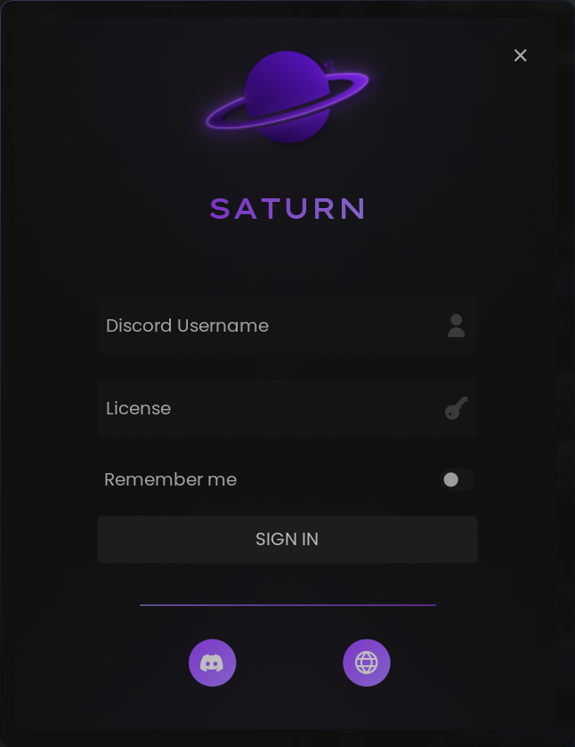

# Saturn Spoofer UI

Template di interfaccia costruito su [Dear ImGui](https://github.com/ocornut/imgui) 1.91.7 WIP
con backend Win32 + DirectX 11 e rendering dei font via [FreeType](https://freetype.org/) 2.12.1.



## Cos'è (e cosa non è)

Questo repository contiene **solo l'interfaccia grafica**. Il codice proprio del progetto sono
circa 1230 righe fra `main.cpp`, `main.hpp`, `ui.cpp` e la cartella `custom/`; tutto il resto è
Dear ImGui e FreeType.

Nonostante il nome, **non c'è alcuna logica di spoofing**. I file che sembrano suggerirla sono
widget di disegno e nient'altro:

- `custom/spoof.cpp` (19 righe) disegna un riquadro con titolo, descrizione e un pulsante, e
  restituisce `true` al click
- `custom/seiral.cpp` (8 righe) disegna un'etichetta e una stringa, colorata di bianco, verde o
  rosso a seconda di un enum `SerialStatus` passato dal chiamante

Cercando nel sorgente le API che servirebbero davvero — `WinHttp*`, `socket`,
`CreateRemoteThread`, `WriteProcessMemory`, `VirtualAllocEx`, `OpenProcess`, `NtLoadDriver`,
`DeviceIoControl`, `RegSetValue`, `GetVolumeInformation`, `SetupDiGetClassDevs`, `CreateProcess`,
`ShellExecute` — non c'è **nessun riscontro**. Il programma apre una finestra, la disegna, e basta.

## Build

Serve Visual Studio 2022 con il carico di lavoro "Sviluppo di applicazioni desktop con C++"
e un Windows SDK 10.

```
msbuild Framework\Framework.vcxproj /p:Configuration=Release /p:Platform=x64
```

Solo **x64**: la `freetype.lib` inclusa è a 64 bit.

### Modifiche fatte per renderlo compilabile

1. **D3DX11.** `main.hpp` linkava `D3DX11.lib`, includeva `<D3DX11tex.h>` e la macro `EIMAGE`
   chiamava `D3DX11CreateShaderResourceViewFromMemory()`. Fa parte del DirectX SDK di giugno 2010,
   deprecato e non più installabile insieme ai Windows SDK moderni. Sostituito con un decoder
   basato su **WIC** (`CreateSRVFromMemory()` in `main.hpp`), che usa solo `windowscodecs.lib` dal
   Windows SDK. La macro `EIMAGE` resta invariata per i chiamanti: `ui.cpp` la usa due volte,
   per il logo e per lo sfondo.

2. **Percorsi del DirectX SDK nel progetto.** `AdditionalIncludeDirectories` puntava a
   `C:\Program Files (x86)\Microsoft DirectX SDK (June 2010)\Include` e
   `AdditionalLibraryDirectories` a `$(DXSDK_DIR)/Lib/x64`, entrambi inesistenti senza quell'SDK.
   Il primo è stato rimosso, il secondo sostituito con `..\Framework\__ext\freetype\win64`, che è
   dove sta davvero la libreria da linkare.

### Nota su `freetype.lib`

`Framework/__ext/freetype/win64/freetype.lib` è un binario precompilato da 4,4 MB che arrivava
nell'archivio originale: non l'ho compilato io e non posso garantirne la provenienza. A differenza
di altri pacchetti simili, qui il **sorgente di FreeType non è incluso** — ci sono solo gli header.
Per ricostruirla serve scaricare FreeType 2.12.1 dal sito ufficiale.

## Licenze e crediti

L'archivio originale **non conteneva alcun file di licenza**, nonostante ridistribuisca due
librerie che lo richiedono. Sono stati aggiunti qui:

- **Dear ImGui** — MIT, Copyright (c) 2014-2023 Omar Cornut. Vedi
  [`LICENSE-dear-imgui.txt`](LICENSE-dear-imgui.txt).
- **FreeType 2.12.1** — doppia licenza FTL / GPLv2. Vedi
  [`licenses-freetype/`](licenses-freetype/).
- **Template UI** — il design dell'interfaccia non è opera mia e l'archivio originale non riporta
  un autore. Se sei l'autore e vuoi che questo repository venga rimosso o che l'attribuzione
  cambi, apri una issue.
